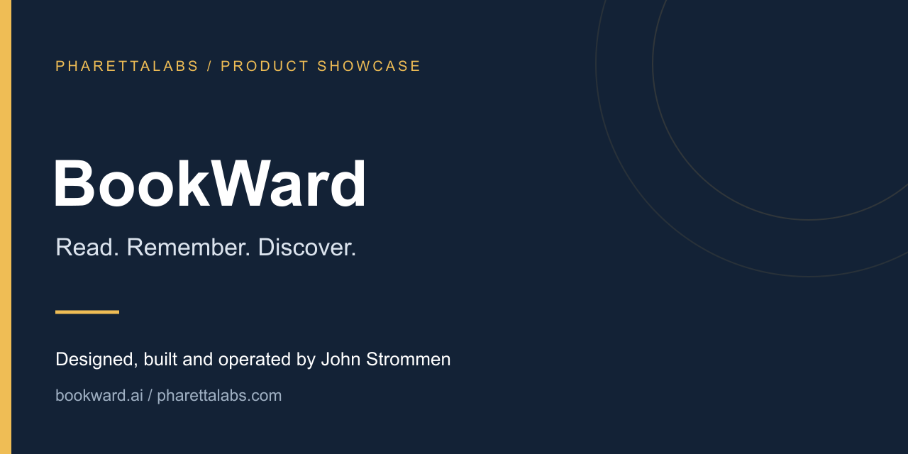
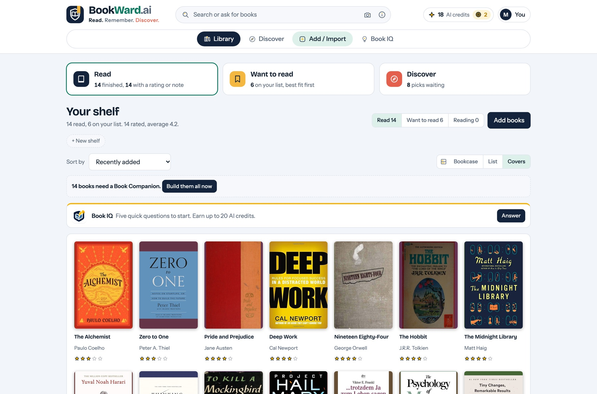
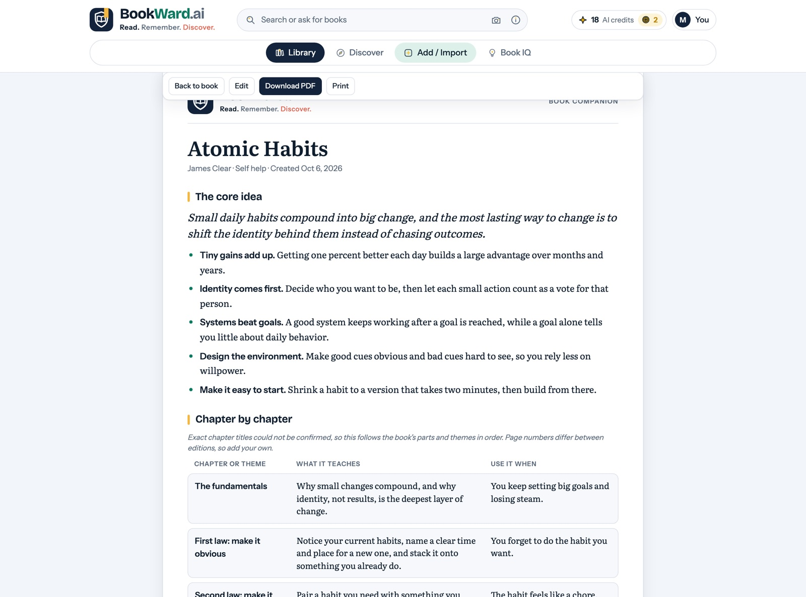
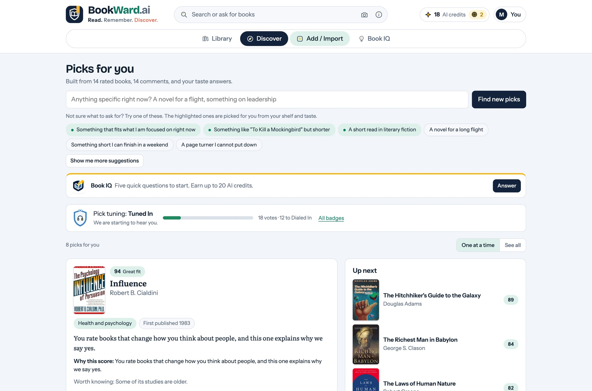

# BookWard

A personal reading app that connects what you read, what you remember, and what you might enjoy next.

[Visit the app](https://bookward.ai) · [Watch the walkthrough](https://www.youtube.com/watch?v=3_CmApwLhYg) · [Read the case study](https://pharettalabs.com/work/bookward/)

> Public product showcase. This repository documents an independently built PharettaLabs product; it does not contain the application's proprietary source code.

## Why I built it

I wanted to refer to books in conversations but often forgot which book an idea came from. My first workaround was AI-generated summaries stored in Google Drive. That became Book Companions: editable, personalized guides inside an app that could also learn from my reading preferences.

## My role

I am John Strommen, founder of [PharettaLabs](https://pharettalabs.com). I led product discovery, prioritization, experience design, full-stack implementation, AI and service integrations, launch, and ongoing iteration. I use AI-assisted development tools with hands-on direction, review, and testing.

## What it does

- Personalized, editable AI Book Companions for remembering ideas from books.
- BookIQ recommendations shaped by ratings, preferences, and reader feedback.
- A “Prove Me Wrong” discovery feature that explores beyond the usual recommendation pattern.
- Reading goals, custom shelves, and library tracking.
- Library imports from existing trackers and pasted lists, plus cover and barcode scanning.
- Public Top 100 and rising-book rankings for exploring reading trends.

## See the product

*Public product screenshots illustrating the library, a Book Companion, and personalized discovery. Screens may differ from the current release.*

## The hardest part

Book data is fragmented across providers, countries, languages, and editions. The hard work involved combining sources, matching titles and authors, resolving duplicates, and supporting useful search alongside covers and previews. Personalization also needed to support discovery without narrowing every recommendation to the same pattern.

## Technology and architecture

| Technology | Role |
| --- | --- |
| Supabase | Application data and backend services |
| Anthropic API | Book Companions and personalized AI features |
| Netlify | Hosting and delivery |
| Resend | Transactional email |
| Multiple book-data sources | Catalog metadata, covers, previews, and discovery |
| Device capabilities | Camera-based scanning and notifications |

**Conceptual flow:** Book sources and library imports → catalog matching and reader preferences → personal library, Book Companions, and recommendations.

This is a high-level product overview, rather than a complete infrastructure or security specification.

## What this demonstrates

Catalog normalization, search, imports, recommendation design, AI personalization, and connecting public discovery content to a product.

My background in enterprise SEO, organic growth, and product leadership informs how I approach discovery, acquisition, usability, and ongoing product operation alongside the build.

## Explore the other products

- [Second Summit](https://github.com/johnstrommen-jstro306/second-summit-showcase) — Your experience. Your next chapter.
- [Punch List](https://github.com/johnstrommen-jstro306/punch-list-showcase) — Less juggling. More getting things done.

## Have a problem worth solving?

Through [PharettaLabs](https://pharettalabs.com), I build custom apps and business tools, connect existing systems, add useful AI features, and advise on product and organic growth.

[Start a conversation in the Idea Lab](https://pharettalabs.com/start/) · [LinkedIn](https://www.linkedin.com/in/johnstrommen/) · [Email](mailto:john@pharettalabs.com)

---

Product names, brand assets, and application source remain the property of their respective owners. No open-source license is granted by this showcase.
